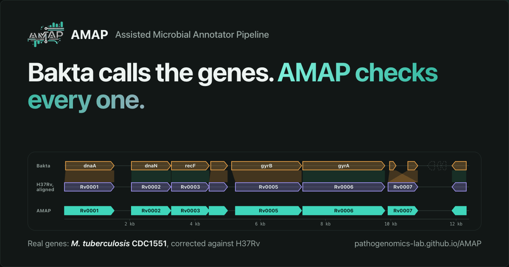
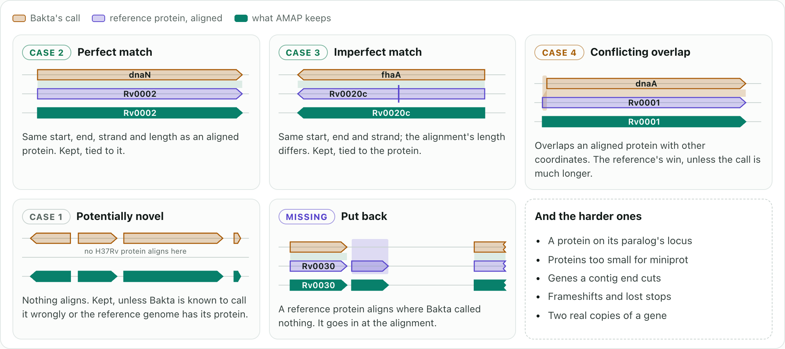
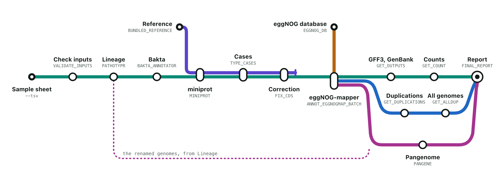

# AMAP: Assisted Microbial Annotator Pipeline  
[](https://github.com/PathoGenOmics-Lab)
[](https://github.com/PathoGenOmics-Lab/AMAP)
[](https://github.com/nextflow-io/nextflow)
[](https://github.com/PathoGenOmics-Lab/AMAP/blob/main/LICENSE)
[](https://hub.docker.com/repository/docker/paururo/amap/general)
[](https://doi.org/10.5281/zenodo.8024447)
[](https://pathogenomics-lab.github.io/AMAP/)

__Paula Ruiz-Rodriguez<sup>1</sup>__ 
__and Mireia Coscolla<sup>1</sup>__
<br>
<sub> 1. I<sup>2</sup>SysBio, University of Valencia-CSIC, FISABIO Joint Research Unit Infection and Public Health, Valencia, Spain </sub>  

<p align="center">
  <a href="https://pathogenomics-lab.github.io/AMAP/"></a>
</p>

AMAP annotates assembled bacterial genomes with Bakta, aligns a trusted
reference proteome onto them with miniprot, and settles every disagreement
between the two: late starts, genes split in two, calls that are not genes,
genes Bakta missed. Built for the *Mycobacterium tuberculosis* complex, where it
changes about 30% of the genes, and for any species you have a trusted
annotation for (`--ref_annotation` + `--ref_genome`).

**[The website](https://pathogenomics-lab.github.io/AMAP/)**: [start here](https://pathogenomics-lab.github.io/AMAP/index.html#start),
[the tutorial](https://pathogenomics-lab.github.io/AMAP/getting-started/tutorial.html),
[how it works, step by step](https://pathogenomics-lab.github.io/AMAP/how-it-works.html), and
[the documentation](https://pathogenomics-lab.github.io/AMAP/documentation.html).

| | |
| :--- | :--- |
| [Quickstart](https://pathogenomics-lab.github.io/AMAP/getting-started/quickstart.html) | From an installed Nextflow to an open report |
| [Parameters](https://pathogenomics-lab.github.io/AMAP/user-guide/parameters.html) | Every flag and its default |
| [Outputs](https://pathogenomics-lab.github.io/AMAP/user-guide/outputs.html) | What every file is |
| [The correction algorithm](https://pathogenomics-lab.github.io/AMAP/how-it-works/correction-algorithm.html) | Every rule and threshold, drawn on real genes |
| [Custom reference](https://pathogenomics-lab.github.io/AMAP/user-guide/custom-reference.html) | Annotating non-MTBC organisms |
| [Troubleshooting](https://pathogenomics-lab.github.io/AMAP/deployment/troubleshooting.html) | When a run fails |

## What AMAP decides

Every Bakta call is compared with where the reference proteins align, on the
same strand of the same contig. That puts it in one of four cases, and a
reference gene with no call at all is a fifth. These are real genes of
*M. tuberculosis* CDC1551; [step through each one](https://pathogenomics-lab.github.io/AMAP/how-it-works.html)
on the website.

<picture>
  <source media="(prefers-color-scheme: dark)" srcset="docs/assets/readme/outcomes-dark.png">
  
</picture>

## Does it work?

[`tests/benchmark`](tests/benchmark) runs the correction on seven genomes and
scores it against an annotation AMAP did not make: the reference's own genes,
carried onto the other genomes by a whole-genome alignment. Every gene a genome
carries unchanged is found at exactly its coordinates, under its name; of the
genes that changed, 99.8 to 100% still sit where the alignment puts them,
under their name.

| Genome | Unchanged genes, exact | Changed genes, found |
| :--- | ---: | ---: |
| *M. tuberculosis* H37Rv, against itself | 4026 / 4026 | |
| H37Rv CP110619, against H37Rv | 3986 / 3986 | 50 / 50 |
| *M. tuberculosis* CDC1551, against H37Rv | 3097 / 3097 | 860 / 862 |
| *M. bovis* AF2122/97, against H37Rv | 2391 / 2391 | 1515 / 1515 |
| CDC1551 cut into 40 contigs | 3072 / 3072 | |
| *E. coli* K-12, against itself | 4286 / 4286 | |
| *E. coli* O157:H7 Sakai, against K-12 | 220 / 220 | 3363 / 3367 |

## The pipeline

Stations are the processes of `main.nf`, in the order its workflow runs them;
lines are what travels between them. On the website the map is
[interactive](https://pathogenomics-lab.github.io/AMAP/how-it-works/workflow.html).

<picture>
  <source media="(prefers-color-scheme: dark)" srcset="docs/assets/readme/metro-dark.png">
  
</picture>

1. **Database setup** ([eggNOG](https://github.com/eggnogdb/)): builds the eggNOG database if it is not already there.
2. **MTBC lineage typing** ([pathotypr](https://github.com/PathoGenOmics-Lab/pathotypr)): assigns lineages from phylogenetic markers and renames the genomes accordingly. Turned off with `--skip_typing`.
3. **Genome annotation** ([Bakta](https://github.com/oschwengers/bakta)): CDS, tRNAs and other features, the baseline that AMAP corrects.
4. **Protein alignment** ([miniprot](https://github.com/lh3/miniprot)): the reference proteome aligned onto each genome.
5. **CDS case classification**: every CDS sorted by how it relates to the reference (novel, perfect match, imperfect match, conflicting coordinates, or a reference gene the annotator missed).
6. **Annotation correction**: conflicts resolved, coordinates adjusted and every gene translated into a corrected gene set.
7. **Functional annotation** ([eggNOG-mapper](https://github.com/eggnogdb/eggnog-mapper)): COG, KEGG, GO, EC, PFAM and CAZy assignments, and the corrected GFF3 and GenBank.
8. **Gene duplication analysis**: duplication families per genome, plus homologous communities across genomes with network metrics.
9. **Pangenome analysis** ([pangene](https://github.com/lh3/pangene)): gene content compared across the whole set.
10. **Report**: a single self-contained HTML file covering all of the above.

Mycobrowser's functional categories describe tuberculosis genes, so they are
skipped on their own when a custom reference is not a *Mycobacterium*; lineage
typing is turned off with `--skip_typing`.

## Quickstart

You need [Nextflow](https://www.nextflow.io/) 24.04 or newer and a container
engine. Nothing else: every tool lives in the AMAP image, and there is no need
to clone this repository.

```bash
conda create -n nextflow-env
conda activate nextflow-env
conda install -c bioconda nextflow
```

Check the installation. This annotates the reference genome bundled in the
container, so you need no data of your own:

```bash
nextflow run PathoGenOmics-Lab/AMAP -profile docker,test
```

Write a tab-separated sample sheet:

```tsv
sampleId	fasta
G26689	/data/genomes/G26689.fasta
G26690	/data/genomes/G26690.fasta
```

And run it:

```bash
# Local machine, Docker
nextflow run PathoGenOmics-Lab/AMAP -profile docker --tsv samples.tsv

# HPC cluster, Singularity and SLURM
nextflow run PathoGenOmics-Lab/AMAP -profile singularity,slurm --tsv samples.tsv

# A non-MTBC organism, with your own reference
nextflow run PathoGenOmics-Lab/AMAP -profile docker \
    --tsv samples.tsv \
    --skip_typing --skip_mycobrowser \
    --genus Escherichia --species "Escherichia coli" \
    --ref_annotation my_reference.gbk --ref_genome my_reference.fasta
```

`--validate_only` checks every FASTA and database path without running anything,
which is worth doing before a long run.

See [running AMAP](https://pathogenomics-lab.github.io/AMAP/user-guide/running.html)
for the full set of profiles and options.

## Results

Everything lands under `--outdir`, `results/` by default. The three to open
first:

| What | Where |
| :--- | :--- |
| The full interactive report | `results/final_report.html` |
| Corrected annotation, per sample | `results/AMAP/{sampleId}/*-AMAP.gff3` |
| Proteins for downstream tools | `results/AMAP/{sampleId}/*-AMAP.clean.faa` |

Alongside them, `results/pipeline_info/` holds `software_versions.yml` and
`params.yml`, which are what belongs in a methods section. Every directory is
documented under
[outputs](https://pathogenomics-lab.github.io/AMAP/user-guide/outputs.html).

## Development

```bash
git clone https://github.com/PathoGenOmics-Lab/AMAP
cd AMAP
pip install -r requirements-test.txt
python -m pytest tests/ -v
```

The website is plain HTML in `docs/`. After editing a page's markdown, rebuild
the pages and check them against the pipeline:

```bash
python3 tools/build_docs.py
python3 tools/check_site.py
```

See
[contributing](https://pathogenomics-lab.github.io/AMAP/about/contributing.html).

## Citation

>Ruiz-Rodriguez, P., & Coscolla, M. (2026). AMAP (Version 1.0.1) [Computer software]. https://doi.org/10.5281/zenodo.8024447
```bibtex
@software{Ruiz-Rodriguez_AMAP_2026,
  author = {Ruiz-Rodriguez, Paula and Coscolla, Mireia},
  doi = {10.5281/zenodo.8024447},
  license = {GPL-3.0},
  month = apr,
  title = {{AMAP}},
  url = {https://github.com/PathoGenOmics-Lab/AMAP},
  version = {1.0.1},
  year = {2026}}
```
---
<h2 id="contributors" align="center">

✨ [Contributors]((https://github.com/PathoGenOmics-Lab/AMAP/graphs/contributors))
</h2>

<!-- ALL-CONTRIBUTORS-LIST:START - Do not remove or modify this section -->
<!-- prettier-ignore-start -->
<!-- markdownlint-disable -->
<div align="center">
AMAP is developed with ❤️ by:
<table>
  <tr>
    <td align="center">
      <a href="https://github.com/paururo">
        
        <br />
        <sub><b>Paula Ruiz-Rodriguez</b></sub>
      </a>
      <br />
      <a href="" title="Code">💻</a>
      <a href="" title="Research">🔬</a>
      <a href="" title="Ideas">🤔</a>
      <a href="" title="Data">🔣</a>
      <a href="" title="Desing">🎨</a>
      <a href="" title="Tool">🔧</a>
    </td> 
    <td align="center">
      <a href="https://github.com/mireiacoscolla">
        
        <br />
        <sub><b>Mireia Coscolla</b></sub>
      </a>
      <br />
      <a href="https://www.uv.es/instituto-biologia-integrativa-sistemas-i2sysbio/es/investigacion/proyectos/proyectos-actuales/mol-tb-host-1286169137294/ProjecteInves.html?id=1286289780236" title="Funding/Grant Finders">🔍</a>
      <a href="" title="Ideas">🤔</a>
      <a href="" title="Mentoring">🧑‍🏫</a>
      <a href="" title="Research">🔬</a>
      <a href="" title="User Testing">📓</a>
    </td> 
  </tr>
</table>

This project follows the [all-contributors](https://github.com/all-contributors/all-contributors) specification ([emoji key](https://allcontributors.org/docs/en/emoji-key)).

<!-- markdownlint-restore -->
<!-- prettier-ignore-end -->

<!-- ALL-CONTRIBUTORS-LIST:END -->
---  
<h2 id="contributors" align="center">
💻 Software Used
</h2>

| Software                                                  | Version | Type     | Usage                           |
|-----------------------------------------------------------|---------|----------|---------------------------------|
| **Pipeline & Orchestration** | | | |
| [Nextflow](https://github.com/nextflow-io/nextflow)       | ≥24.04  | Workflow | Pipeline orchestration          |
| [Docker](https://www.docker.com/)                         | ≥25.0   | Container| Containerization                |
| [Singularity](https://sylabs.io/singularity/)             | ≥3.11   | Container| Containerization (HPC)          |
| **Bioinformatics Tools** | | | |
| [Bakta](https://github.com/oschwengers/bakta)             | 1.12.0  | Tool     | Genome Annotation               |
| [miniprot](https://github.com/lh3/miniprot)               | 0.18    | Tool     | Protein-to-genome Alignment     |
| [pangene](https://github.com/lh3/pangene)                 | 1.1     | Tool     | Pangenome Graph Construction    |
| [DIAMOND](https://github.com/bbuchfink/diamond)           | 2.1.24  | Tool     | Fast Protein Alignment          |
| [eggNOG-mapper](https://github.com/eggnogdb/eggnog-mapper)| 2.1.13  | Tool     | Functional Annotation           |
| [Pathotypr](https://github.com/PathoGenOmics-Lab/pathotypr)| 1.0.0  | Tool     | MTBC Lineage Typing             |
| [gfatools](https://github.com/lh3/gfatools)              | 0.5     | Tool     | GFA Graph Utilities             |
| **Python** | | | |
| [Python](https://www.python.org/)                         | 3.9     | Runtime  | Programming Language            |
| [pandas](https://github.com/pandas-dev/pandas)            | ≥2.0    | Library  | Data Analysis                   |
| [NumPy](https://numpy.org/)                               | ≥1.24   | Library  | Numerical Computing             |
| [Biopython](https://biopython.org/)                       | ≥1.83   | Library  | Sequence Manipulation           |
| [matplotlib](https://matplotlib.org/)                     | ≥3.7    | Library  | Static Visualization            |
| [plotly.py](https://github.com/plotly/plotly.py)          | ≥5.0    | Library  | Interactive Visualization       |
| [NetworkX](https://networkx.org/)                         | ≥3.0    | Library  | Network Analysis                |
| [intervaltree](https://github.com/chaimleib/intervaltree) | ≥3.1    | Library  | Overlap Detection               |
| [python-louvain](https://github.com/taynaud/python-louvain)| ≥0.16  | Library  | Community Detection             |
| [pyvis](https://github.com/WestHealth/pyvis)             | 0.3.2   | Library  | Network Visualization           |
| **R** | | | |
| [R](https://www.R-project.org/)                           | 4.4     | Runtime  | Statistical Computing           |
| [ggplot2](https://ggplot2.tidyverse.org/)                 | ≥3.5    | Package  | Data Visualization              |
| [dplyr](https://dplyr.tidyverse.org/)                     | ≥1.1    | Package  | Data Manipulation               |
| [tidyr](https://tidyr.tidyverse.org/)                     | ≥1.3    | Package  | Data Tidying                    |
| [plotly (R)](https://plotly-r.com/)                        | ≥4.10   | Package  | Interactive Plots               |
| [ggpubr](https://rpkgs.datanovia.com/ggpubr/)            | ≥0.6    | Package  | Publication-ready Plots         |
| [pheatmap](https://cran.r-project.org/package=pheatmap)   | ≥1.0    | Package  | Heatmap Visualization           |
| [DT](https://rstudio.github.io/DT/)                      | ≥0.30   | Package  | Interactive Tables              |
| [rmarkdown](https://rmarkdown.rstudio.com/)              | ≥2.25   | Package  | Report Rendering                |
| [ggsimplestats](https://github.com/maximilian-heeg/ggsimplestats) | latest | Package | Statistical Annotations  |

<div align="justify">
