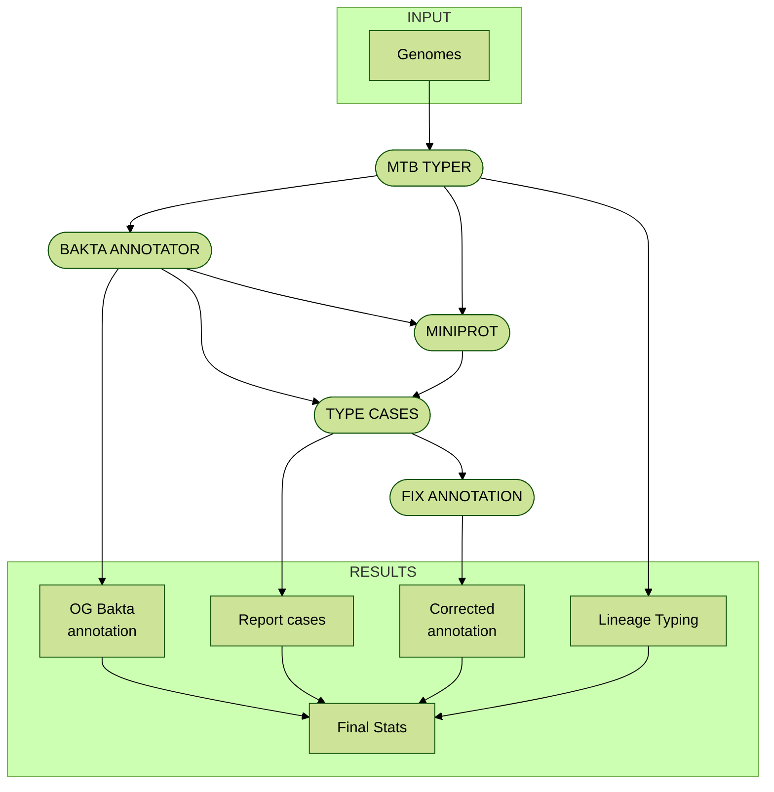

<h0 id="badges" align="center">

</h0>

<h0 id="contributors" align="justify">

# AMAP: Assisted MTBC annotator pipeline  

__Paula Ruiz-Rodriguez1__ 
__and Mireia Coscolla1__
 
 1. I2SysBio, University of Valencia-CSIC, FISABIO Joint Research Unit Infection and Public Health, Valencia, Spain   

AMAP is a bioinformatics pipeline in nextflow for processing, annotating and correct annotations of _Mycobacterium tuberculosis_ complex (MTBC) genomes.
## Installation  

## Run AMAP in Nextflow  

## AMAP flowchart

---
<h2 id="contributors" align="center">
✨ Contributors
</h2>

<!-- ALL-CONTRIBUTORS-LIST:START - Do not remove or modify this section -->
<!-- prettier-ignore-start -->
<!-- markdownlint-disable -->

AMAP is developed with ❤️ by:
<table>
  <tr>
    <td align="center">
      <a href="https://github.com/paururo">
        
         
        <b>Paula Ruiz-Rodriguez</b>
      </a>
       
      <a href="" title="Code">💻</a>
      <a href="" title="Research">🔬</a>
      <a href="" title="Ideas">🤔</a>
      <a href="" title="Data">🔣</a>
      <a href="" title="Desing">🎨</a>
      <a href="" title="Tool">🔧</a>
    </td> 
    <td align="center">
      <a href="https://github.com/mireiacoscolla">
        
         
        <b>Mireia Coscolla</b>
      </a>
       
      <a href="https://www.uv.es/instituto-biologia-integrativa-sistemas-i2sysbio/es/investigacion/proyectos/proyectos-actuales/mol-tb-host-1286169137294/ProjecteInves.html?id=1286289780236" title="Funding/Grant Finders">🔍</a>
      <a href="" title="Ideas">🤔</a>
      <a href="" title="Mentoring">🧑‍🏫</a>
      <a href="" title="Research">🔬</a>
      <a href="" title="User Testing">📓</a>
    </td> 
  </tr>
</table>

This project follows the [all-contributors](https://github.com/all-contributors/all-contributors) specification ([emoji key](https://allcontributors.org/docs/en/emoji-key)).

<!-- markdownlint-restore -->
<!-- prettier-ignore-end -->

<!-- ALL-CONTRIBUTORS-LIST:END -->
---  
<h2 id="contributors" align="center">
💻 Software Used
</h2>

| Software          | Version | Type   | Usage                 |
|-------------------|---------|--------|-----------------------|
| [Nextflow](https://github.com/nextflow-io/nextflow)     | 23.10.1 | Other  | Workflow Management   |
| [Bakta](https://github.com/oschwengers/bakta)           | 1.9.3   | Other  | Annotation Tools  |
| [miniprot](https://github.com/lh3/miniprot)             | 0.13    | Other  | Mapping Tools  |
| [Python](https://www.python.org/)                        | 3.9     | Python | Programming Language  |
| [R](https://www.R-project.org/)                          | 4.3.3   | R      | Statistical Computing |
| [pandas](https://github.com/pandas-dev/pandas)           | 2.2.1   | Python | Data Analysis         |
| [intervaltree](https://github.com/chaimleib/intervaltree) | 3.1.0 | Other  | Data Structures       |
| [plotly.py](https://github.com/plotly/plotly.py)         | 5.20.0  | Python | Data Visualization    |
| [ggplot2](https://ggplot2.tidyverse.org/index.html)      | 3.5.0   | R      | Data Visualization    |
| [dplyr](https://dplyr.tidyverse.org/)                    | 1.1.4   | R      | Data Manipulation     |
| [Singularity](https://sylabs.io/singularity/)           | 3.11.1   | Other  | Containerization      |
| [Docker](https://www.docker.com/)                        | 25.0.4   | Other  | Containerization      |

