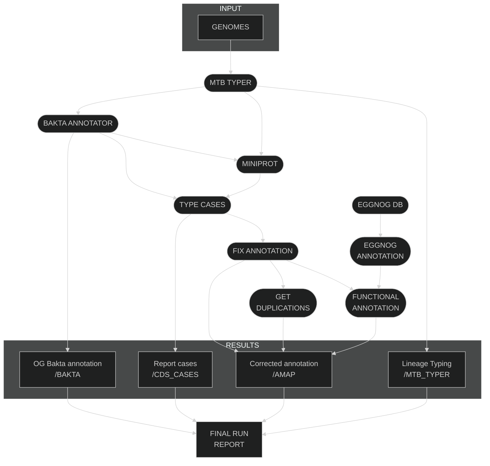

[](https://github.com/PathoGenOmics-Lab)
[](https://github.com/PathoGenOmics-Lab/AMAP)
[](https://github.com/nextflow-io/nextflow/releases/tag/v23.10.1)
[](https://github.com/PathoGenOmics-Lab/AMAP/blob/main/LICENSE)
[](https://hub.docker.com/repository/docker/paururo/amap/general)
[](https://doi.org/10.5281/zenodo.8024447)

# AMAP: Assisted MTBC annotator pipeline  
__Paula Ruiz-Rodriguez<sup>1</sup>__ 
__and Mireia Coscolla<sup>1</sup>__
<br>
<sub> 1. I<sup>2</sup>SysBio, University of Valencia-CSIC, FISABIO Joint Research Unit Infection and Public Health, Valencia, Spain </sub>  

<p align="center">
  
</p>

AMAP is a bioinformatics pipeline written in Nextflow for processing, annotating and correct annotations of _Mycobacterium tuberculosis_ complex (MTBC) genomes.
## First Steps for Using AMAP

**Why Choose Nextflow with Conda and Singularity?** 
Nextflow excels in managing complex workflows, offering reproducibility, scalability, and portability. It's particularly effective for bioinformatics and data analysis tasks. Nextflow's support for containerization with Docker and Singularity ensures consistent and isolated execution environments. Conda complements this by simplifying the package management process.

### Installation Guide

To set up your environment with Nextflow and Singularity, follow these straightforward steps:

1. **Install Nextflow Using Conda**:
   Begin by downloading Miniconda, a lightweight version of Conda, which simplifies package management. You can find it at [Miniconda's official site](https://docs.conda.io/en/latest/miniconda.html).
2. **Create and Activate a Conda Environment**:
   Organize your packages and dependencies in an isolated environment to avoid conflicts.
   ```bash
   conda create -n nextflow-env
   conda activate nextflow-env
3. **Install Nextflow in Conda Environment**:
   With the Conda environment ready, install Nextflow seamlessly.
   ```bash
   conda install -c bioconda nextflow
   ```
4. **Install Singularity**:
   To handle containerization, install Singularity following the detailed instructions in the [Singularity Installation Guide](https://docs.sylabs.io/guides/4.1/user-guide/quick_start.html).
5. **Verify Installation**:
   Confirm that Nextflow and Singularity are correctly installed and ready to use.
   ```bash
   nextflow -version
   singularity --version
   ```
These steps ensure that you have a robust setup for running reproducible data analysis workflows using Nextflow, Conda, and Singularity.

### Running AMAP
Nextflow facilitates the direct execution of pipelines from GitHub repositories. This approach simplifies the process and does not require cloning the repository locally.

To run the AMAP pipeline hosted on GitHub by PathoGenOmics-Lab, follow these simple steps:

1. **Prepare Your Environment**:
   Ensure that Nextflow and Singularity are installed and properly configured in your Conda environment as previously detailed.

2. **Run the Pipeline**:
   Execute the AMAP pipeline directly from GitHub with Nextflow. Replace `[parameters]` with the specific parameters needed for your analysis.
   ```bash
   nextflow run PathoGenOmics-Lab/AMAP --tsv test_file.tsv
   ```

## Parameters

## Inputs

## Outputs

## AMAP Workflow

## AMAP Algorithm

## Citation
>Ruiz-Rodriguez, P., & Coscolla, M. (2024). AMAP (Version 0.1.0) [Computer software]. https://doi.org/10.5281/zenodo.1234
```bibtex
@software{Ruiz-Rodriguez_AMAP_2023,
  author = {Ruiz-Rodriguez, Paula and Coscolla, Mireia},
  doi = {10.5281/zenodo.1234},
  license = {GPL-3.0},
  month = jul,
  title = {{AMAP}},
  url = {https://github.com/PathoGenOmics-Lab/AMAP},
  version = {0.1.0},
  year = {2024}}
```
---
<h2 id="contributors" align="center">

✨ [Contributors]((https://github.com/PathoGenOmics-Lab/AMAP/graphs/contributors))
</h2>

<!-- ALL-CONTRIBUTORS-LIST:START - Do not remove or modify this section -->
<!-- prettier-ignore-start -->
<!-- markdownlint-disable -->
<div align="center">
AMAP is developed with ❤️ by:
<table>
  <tr>
    <td align="center">
      <a href="https://github.com/paururo">
        
        <br />
        <sub><b>Paula Ruiz-Rodriguez</b></sub>
      </a>
      <br />
      <a href="" title="Code">💻</a>
      <a href="" title="Research">🔬</a>
      <a href="" title="Ideas">🤔</a>
      <a href="" title="Data">🔣</a>
      <a href="" title="Desing">🎨</a>
      <a href="" title="Tool">🔧</a>
    </td> 
    <td align="center">
      <a href="https://github.com/mireiacoscolla">
        
        <br />
        <sub><b>Mireia Coscolla</b></sub>
      </a>
      <br />
      <a href="https://www.uv.es/instituto-biologia-integrativa-sistemas-i2sysbio/es/investigacion/proyectos/proyectos-actuales/mol-tb-host-1286169137294/ProjecteInves.html?id=1286289780236" title="Funding/Grant Finders">🔍</a>
      <a href="" title="Ideas">🤔</a>
      <a href="" title="Mentoring">🧑‍🏫</a>
      <a href="" title="Research">🔬</a>
      <a href="" title="User Testing">📓</a>
    </td> 
  </tr>
</table>

This project follows the [all-contributors](https://github.com/all-contributors/all-contributors) specification ([emoji key](https://allcontributors.org/docs/en/emoji-key)).

<!-- markdownlint-restore -->
<!-- prettier-ignore-end -->

<!-- ALL-CONTRIBUTORS-LIST:END -->
---  
<h2 id="contributors" align="center">
💻 Software Used
</h2>

| Software                                                  | Version | Type     | Usage                           |
|-----------------------------------------------------------|---------|----------|---------------------------------|
| [Nextflow](https://github.com/nextflow-io/nextflow)       | 23.10.1 | Nextflow | Workflow Management             |
| [Bakta](https://github.com/oschwengers/bakta)             | 1.9.3   | Other    | Annotation Tools                |
| [miniprot](https://github.com/lh3/miniprot)               | 0.13    | Other    | Mapping Tools                   |
| [Python](https://www.python.org/)                         | 3.9     | Python   | Programming Language            |
| [R](https://www.R-project.org/)                           | 4.3.3   | R        | Statistical Computing           |
| [pandas](https://github.com/pandas-dev/pandas)            | 2.2.1   | Python   | Data Analysis                   |
| [intervaltree](https://github.com/chaimleib/intervaltree) | 3.1.0   | Python   | Data Structures                 |
| [plotly.py](https://github.com/plotly/plotly.py)          | 5.20.0  | Python   | Data Visualization              |
| [ggplot2](https://ggplot2.tidyverse.org/index.html)       | 3.5.0   | R        | Data Visualization              |
| [dplyr](https://dplyr.tidyverse.org/)                     | 1.1.4   | R        | Data Manipulation               |
| [Singularity](https://sylabs.io/singularity/)             | 3.11.1  | Other    | Containerization                |
| [Docker](https://www.docker.com/)                         | 25.0.4  | Other    | Containerization                |
| [Conda](https://docs.conda.io/en/latest/)                 | 24.1.2  | Other    | Package/Environment Management  |
| [eggnog-mapper](https://github.com/eggnogdb/eggnog-mapper)| 2.1.12  | Python   | Annotation Tools                |

<div align="justify">
