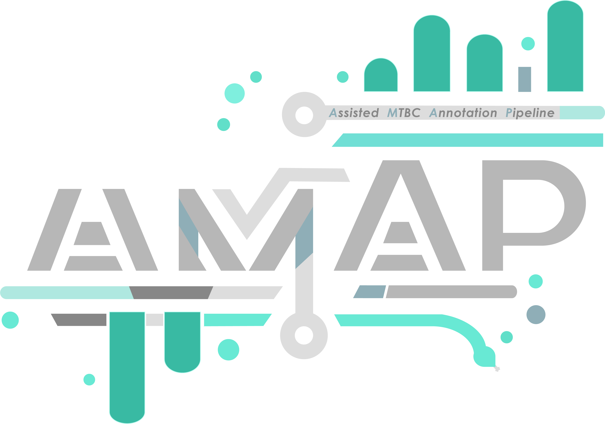
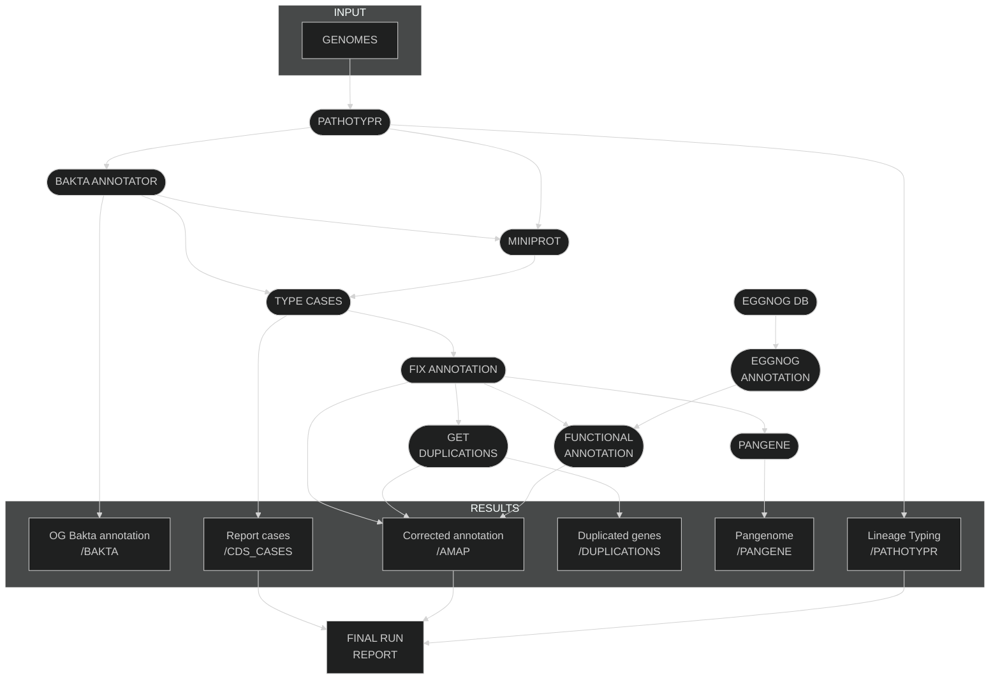

# AMAP: Assisted MTBC annotator pipeline  
[](https://github.com/PathoGenOmics-Lab)
[](https://github.com/PathoGenOmics-Lab/AMAP)
[](https://github.com/nextflow-io/nextflow/releases/tag/v23.10.1)
[](https://github.com/PathoGenOmics-Lab/AMAP/blob/main/LICENSE)
[](https://hub.docker.com/repository/docker/paururo/amap/general)
[](https://doi.org/10.5281/zenodo.8024447)

__Paula Ruiz-Rodriguez<sup>1</sup>__ 
__and Mireia Coscolla<sup>1</sup>__
<br>
<sub> 1. I<sup>2</sup>SysBio, University of Valencia-CSIC, FISABIO Joint Research Unit Infection and Public Health, Valencia, Spain </sub>  

<table>
  <tr>
    <td width="350">
      
    </td>
    <td style="padding-left: 20px;">
      <p>AMAP is a bioinformatics pipeline written in Nextflow for processing, annotating and correcting annotations of <em>Mycobacterium tuberculosis</em> complex (MTBC) genomes. The reference-based correction adjusts approximately 30% of the genes in a given genome.</p>
      <p>Although AMAP has been optimized for the MTBC, <strong>its structure allows for adaptation to other organisms</strong> by modifying the reference files and specific parameters.</p>
    </td>
  </tr>
</table>

## What can AMAP do?

AMAP is designed to provide a comprehensive and accurate annotation of MTBC genomes, starting from assembled genome sequences. The pipeline performs a series of steps to classify, annotate, correct, and analyze the genomes.

The main steps of the AMAP workflow are:

1.  **Database Setup ([eggnog](https://github.com/eggnogdb/))**: The pipeline first checks if the necessary EggNOG database exists. If the database (`bacteria.dmnd`) is found, this step is skipped. If not, it proceeds to download and build it before any analysis begins.

2.  **MTBC Lineage Typing ([pathotypr](https://github.com/PathoGenOmics-Lab/pathotypr))**: The pipeline classifies the input genomes into _Mycobacterium tuberculosis_ lineages using robust phylogenetic markers. This step can be skipped if desired. The results of this classification are used to rename the sequences for clarity in downstream analyses.

3.  **Genome Annotation ([bakta](https://github.com/oschwengers/bakta))**: Each genome is then annotated using the **Bakta** tool. This process identifies coding sequences (CDS), tRNAs, and other genomic features, providing a baseline annotation for each genome.

4.  **Protein Alignment ([miniprot](https://github.com/lh3/miniprot))**: The annotated proteins are aligned against a reference proteome (H37Rv) using **miniprot**. This step is crucial for identifying orthologous proteins and assessing the quality of the initial annotation.

5.  **CDS Case Classification ([AMAP](https://github.com/PathoGenOmics-Lab/AMAP))**: Based on the alignments from miniprot, the pipeline classifies each CDS into different "cases" to identify discrepancies between the input genome's annotation and the reference.
    * **Case 1**: Novel CDS not present in the reference.
    * **Case 2**: Perfect match with the reference annotation.
    * **Case 3**: Same start or end as the reference but with mismatches.
    * **Case 4**: CDS coordinates corrected by AMAP.
    * **Missing RVs**: Reference genes that were not annotated by Bakta in the input genome.

6.  **Annotation Correction ([AMAP](https://github.com/PathoGenOmics-Lab/AMAP))**: Using the case classifications, the pipeline corrects the CDS annotations, adjusting start/end coordinates to produce a more accurate set of annotated genes.

7.  **Functional Annotation ([eggNOG-mapper](https://github.com/eggnogdb/eggnog-mapper))**: The corrected protein sequences are functionally annotated using **eggNOG-mapper**. This assigns functional information, such as COG categories, to each gene.

8.  **Gene Duplication Analysis ([AMAP](https://github.com/PathoGenOmics-Lab/AMAP))**: The pipeline identifies and analyzes gene duplications within each genome. It generates a network of duplicated genes and calculates various network metrics to characterize these duplications.

9.  **Pangenome Analysis ([pangene](https://github.com/lh3/pangene))**: AMAP performs a pangenome analysis to compare the gene content across all processed genomes, helping to understand the core and accessory genome of the dataset.

10. **Final Report Generation**: Finally, AMAP generates a comprehensive HTML report summarizing all the results, including distributions, functional summaries, and statistical analyses.


## Parameters

### Input/Output

| Parameter | Description | Type | Default | Required |
| :--- | :--- | :--- | :--- | :--- |
| `--tsv` | Path to the input TSV file. The file should have two columns: `sampleId` and `fasta`, separated by a tab. | `file` | `example_files/test.tsv` | **Yes** |
| `--outdir` | Path to the output directory where the results will be saved. | `string` | `results` | No |

### Optional Arguments

| Parameter | Description | Type | Default |
| :--- | :--- | :--- | :--- |
| `--skip_typing` | Skip the initial PATHOTYPR lineage typing step. | `boolean` | `false` |
| `--skip_functional_annotation` | Skip all functional annotation and downstream analysis steps. | `boolean` | `false` |
| `--genus` | The genus to be used for Bakta annotation. | `string` | `"Mycobacterium"` |
| `--species` | The species to be used for Bakta annotation. | `string` | `"Mycobacterium tuberculosis"` |
| `--help` | Display the help message and exit. | `boolean` | `false` |

### Reference & Database Arguments

**Note**: All the necessary reference files for the standard MTBC analysis are **included in the Docker and Singularity images**. These files, originally sourced from public repositories like Zenodo, are located in the `/reference/` directory inside the container.

Therefore, **you do not need to specify these parameters** if you are running the pipeline with Docker or Singularity for a standard analysis. The pipeline will automatically use the bundled files.

These options are provided for advanced users who wish to:
* Run the pipeline without a container.
* Use custom or updated reference files.
* Adapt the pipeline for other organisms.

| Parameter | Description | Type | Default (within container) |
| :--- | :--- | :--- | :--- |
| `--eggnog_db` | Path to the pre-formatted eggNOG database directory. | `string` | `eggnog_db` |
| `--pathotyper_snps` | Path to the SNPs TSV file for Pathotyper. | `file` | `/reference/snps_lineages.tsv` |
| `--pathotyper_ref` | Path to the reference FASTA file for Pathotyper. | `file` | `/reference/MTB_ancestor_reference.fasta` |
| `--miniprot_ref_aa` | Path to the reference amino acid proteome for Miniprot. | `file` | `/reference/aa_H37Rv.translated.fas` |
| `--miniprot_ref_bad_bakta` | Path to a set of problematic proteins for Miniprot alignment. | `file` | `/reference/bad.bakta.translated.fas` |
| `--miniprot_ref_h37rv` | Path to the reference genome FASTA for Miniprot. | `file` | `/reference/new_refH37Rv.fasta` |
| `--bakta_proteins` | Path to a reference proteins GBK file for Bakta annotation. | `file` | `/reference/sequence.gb` |
| `--mycobrowser_ref` | Path to the Mycobrowser reference TXT file for functional categorization. | `file` | `/reference/Mycobacterium_tuberculosis_H37Rv_txt_v4.txt` |


## First Steps for Using AMAP

**Why Choose Nextflow with Conda and Singularity?** 
Nextflow excels in managing complex workflows, offering reproducibility, scalability, and portability. It's particularly effective for bioinformatics and data analysis tasks. Nextflow's support for containerization with Docker and Singularity ensures consistent and isolated execution environments. Conda complements this by simplifying the package management process.

### Installation Guide

To set up your environment with Nextflow and Singularity, follow these straightforward steps:

1. **Install Nextflow Using Conda**:
   Begin by downloading Miniconda, a lightweight version of Conda, which simplifies package management. You can find it at [Miniconda's official site](https://docs.conda.io/en/latest/miniconda.html).
2. **Create and Activate a Conda Environment**:
   Organize your packages and dependencies in an isolated environment to avoid conflicts.
   ```bash
   conda create -n nextflow-env
   conda activate nextflow-env
3. **Install Nextflow in Conda Environment**:
   With the Conda environment ready, install Nextflow seamlessly.
   ```bash
   conda install -c bioconda nextflow
   ```
4. **Install Singularity**:
   To handle containerization, install Singularity following the detailed instructions in the [Singularity Installation Guide](https://docs.sylabs.io/guides/4.1/user-guide/quick_start.html).
5. **Verify Installation**:
   Confirm that Nextflow and Singularity are correctly installed and ready to use.
   ```bash
   nextflow -version
   singularity --version
   ```
These steps ensure that you have a robust setup for running reproducible data analysis workflows using Nextflow, Conda, and Singularity.

### Running AMAP
Nextflow facilitates the direct execution of pipelines from GitHub repositories. This approach simplifies the process and does not require cloning the repository locally.

To run the AMAP pipeline hosted on GitHub by PathoGenOmics-Lab, follow these simple steps:

1. **Prepare Your Environment**:
   Ensure that Nextflow and Singularity are installed and properly configured in your Conda environment as previously detailed.
> [!NOTE]
> If you are new to Nextflow and nf-core, please refer to [this page](https://nf-co.re/docs/usage/installation) on how to set-up Nextflow. Make sure to [test your setup](https://nf-co.re/docs/usage/introduction#how-to-run-a-pipeline) with `-profile test` before running the workflow on actual data.

2. **Run the Pipeline**:
   Execute the AMAP pipeline directly from GitHub with Nextflow. Replace `[parameters]` with the specific parameters needed for your analysis.
   ```bash
   nextflow run PathoGenOmics-Lab/AMAP --tsv test_file.tsv
   ```
### Advanced Usage

#### Resuming a run
If your run is interrupted for any reason, you can resume it from the last successfully completed step by adding the `-resume` flag to your command:

```bash
nextflow run PathoGenOmics-Lab/AMAP -profile singularity --tsv test_file.tsv -resume
```

#### Running on a SLURM Cluster
The pipeline includes a `slurm` profile for execution on HPC clusters using the SLURM workload manager. To use it, combine it with a container profile like `singularity`:

```bash
nextflow run PathoGenOmics-Lab/AMAP -profile singularity,slurm --tsv test_file.tsv
```
The default Quality of Service (QoS) is set to `short` in the `nextflow.config` file. You can modify this file to change the `clusterOptions` to suit your cluster's configuration (e.g., specifying a different partition or account).


# Detailed Outputs

The pipeline will create a main output directory (specified by `--outdir`, default: `results/`). Within this directory, a structured set of subdirectories will be generated for each step of the analysis.

```
results/
├── AMAP/
│   └── {sampleId}/
│       ├── *-AMAP.faa                   # Final corrected protein sequences in FASTA format.
│       ├── *-AMAP.fna                   # Final corrected nucleotide sequences in FASTA format.
│       ├── *-AMAP.gff3                  # Final corrected annotation in GFF3 format.
│       ├── *-AMAP.gbk                   # Final corrected annotation in GenBank format.
│       ├── *-AMAPmastertable.tsv        # Master table combining all annotation info (coordinates, eggNOG, Mycobrowser).
│       ├── *-AMAP.COG.tsv               # Summary count of COG functional categories.
│       └── *-AMAP.MycoBrowser.tsv       # Summary count of Mycobrowser functional categories.
│
├── BAKTA/
│   └── {sampleId}/
│       ├── *.faa                        # Original protein sequences from Bakta.
│       ├── *.gbff                       # Original GenBank file from Bakta.
│       ├── *.gff3                       # Original GFF3 file from Bakta.
│       ├── *.hypotheticals.faa          # FASTA of hypothetical proteins.
│       ├── *.hypotheticals.tsv          # TSV of hypothetical proteins.
│       ├── *.png                        # Genome map image.
│       ├── *.tsv                        # Original annotation table from Bakta.
│       └── *.txt                        # Summary statistics from Bakta.
│
├── CDS_CASES/
│   ├── summary/
│   │   └── *-summary.tsv                # Summary table of all classified cases across all samples.
│   └── {sampleId}/
│       ├── *-case[1-4].tsv              # Tables for each specific case (novel, perfect match, mismatch, corrected).
│       ├── *-rvmissing.tsv              # Genes from the reference (H37Rv) not found by Bakta.
│       ├── *.html                       # Interactive plots visualizing gene overlaps.
│       └── *_corrected.tsv              # The final list of corrected CDS coordinates before generating new annotation files.
│
├── DUPLICATIONS/
│   ├── {sampleId}/
│   │   ├── duplications*                # Raw BLASTp output for within-genome duplications.
│   │   ├── duplications_*_groups.tsv    # Table grouping duplicated genes into families.
│   │   └── *.dup                        # FASTA file of all duplicated protein sequences for the sample.
│   ├── homologous_communities.tsv       # Summary table of homologous gene communities across all samples, with network metrics.
│   └── homologous_communities.html      # Interactive network visualization of the homologous communities.
│
├── PANGENE/
│   └── {sampleId}/
│       ├── *.gfa                        # Pangenome graph in Graphical Fragment Assembly format.
│       ├── *.bubbles.txt                # Details on structural variations (bubbles) in the graph.
│       ├── *.Rtab                       # Presence/absence matrix of genes across genomes.
│       └── *.stat                       # Statistics of the GFA graph.
│
├── PATHOTYPR/
│   ├── typing/
│   │   └── *_summary.tsv                # Summary of lineage classification from Pathotyper.
│   ├── fastas/
│   │   └── *.fasta                      # Renamed genome FASTA files based on the assigned lineage.
│   └── renamed_fastas.tsv               # TSV file mapping original sample IDs to new lineage-based names.
│
├── pipeline_info/
│   ├── execution_report_*.html          # Nextflow execution report.
│   ├── execution_timeline_*.html        # Nextflow execution timeline.
│   ├── pipeline_dag_*.html              # Pipeline dependency graph (DAG).
│   └── execution_trace_*.txt            # Nextflow execution trace file with resource usage.
│
└── final_report.html                    # The main HTML report summarizing the entire analysis.
```

## Effect of Skip Options

Using optional flags will prevent certain directories and files from being generated:

* **If `--skip_typing` is used:**
    * The entire `PATHOTYPR/` directory will not be created. The pipeline will proceed using the original sample IDs.

* **If `--skip_functional_annotation` is used:**
    * The pipeline will stop after the annotation correction step. The following directories and files **will not be generated**:
        * `AMAP/`
        * `DUPLICATIONS/`
        * `PANGENE/`
        * `final_report.html`

## Network measures of Duplications
1. **Degree Centrality** ``(AverageDegree1-2)``: Measures the number of direct connections a node has. In networks based on pairwise relationships, this measure is crucial for identifying highly connected nodes. Simply put,it is the average number of connections each node in the community has.
2. **Closeness Centrality** ``(AverageCloseness1-2)``: Calculates the average distance of a node to all others in the network, identifying nodes capable of efficiently propagating information. This metric measures how'close' nodes are to each other in terms of steps or hops. A high value indicates that nodes are, on average, closer to each other.
3. **Betweenness Centrality** ``(AverageBetweenness1-2)``: Indicates how often a node acts as a bridge on the shortest path between two other nodes, thus controlling the flow of information. A high value may indicate nodesthat act as 'bridges' between different parts of the network.
4. **Eigen Centrality** ``(Eigen1-2)``: Values the number of connections of a node and the importance of the connected nodes, useful for identifying influential nodes in pairwise networks.
5. **Katz Centrality** ``(Katz1-2)``: Similar to Eigen Centrality, but it considers nodes at greater distances with diminishing weight, useful for identifying influential nodes considering indirect connections.
6. **Network Density** ``(Density1-2)``: The ratio of possible connections that are actual, indicating the degree of interconnection of the network. A density close to 1 indicates a highly connected network, while a lowdensity indicates a more dispersed network.
7. **Clustering Coefficient** ``(ClusteringCoefficient1-2)``: Measures the degree to which nodes cluster together, indicating a well-defined community structure. This metric measures the extent to which nodes in a networktend to cluster or form closed groups. A high value suggests that if two nodes are connected to a third one, they are likely also connected to each other.
8. **Average Path Length** ``(AveragePathLength1-2)``: The average distance between all pairs of nodes, with short lengths indicating a "small world" distance between any pair of nodes. It is the average number of stepsalong the shortest paths for all possible pairs of nodes. A low average path length means that most nodes can be reached from other nodes in a few steps.
9. **Transitivity** ``(transitivity1-2)``: Measures the likelihood that the neighbors of a node are also connected to each other. It is similar to the clustering coefficient but applies to the entire network. It indicatesthe general tendency of the network to form triangles or "three connected friends."
10. **Modularity** ``(modularity1-2)``: Evaluates the community structure within a network. High modularity indicates that the network has densely interconnected communities, but with few connections between these distinct communities. It helps to identify how well defined the communities are within the network.

## AMAP Detailed Workflow


# AMAP Correction Algorithm: A Deeper Look

The core of AMAP's functionality is its algorithm for refining genome annotations. It acts as a "referee" between the initial annotation (from Bakta) and a trusted reference (alignments to the H37Rv proteome via Miniprot). The process involves classifying every potential gene and then applying a set of rules to resolve discrepancies.

---

#### 1. Initial CDS Classification

First, every CDS from the initial Bakta annotation is compared to the Miniprot alignments and categorized:

* **Case 2 (Perfect Match)**: The Bakta CDS has the **exact same start and end coordinates** as a high-quality Miniprot alignment. These are considered correct and are kept.
* **Case 3 (Imperfect Match)**: The Bakta CDS has the same coordinates, but the alignment length differs slightly (e.g., due to indels). These are also kept as they are generally reliable.
* **Case 4 (Conflicting Overlap)**: A Bakta CDS and a Miniprot alignment overlap positionally, but their start/end coordinates do not match. These are conflicts that must be resolved.
* **Case 1 (Potentially Novel)**: A Bakta CDS has **no overlap** with any Miniprot alignment. This suggests it might be a novel gene not present in the H37Rv reference.
* **Missing RVs**: A Miniprot alignment has **no overlap** with any Bakta CDS. This represents a reference gene that the initial annotation tool missed entirely. These are automatically "rescued" and added to the set of trusted genes.

---

#### 2. Conflict Resolution and Decision Logic

The algorithm's main task is to resolve the conflicts from **Case 4** and filter the potentially novel genes from **Case 1**.

* **Filtering Case 1**: Potentially novel genes are scrutinized. A gene is **removed** if:
    * It has an overlap of **≥ 80%** with a database of known false positives or problematic annotations.
    * It shows a weak but significant alignment (**≥ 80%** match identity) to the reference, indicating it's not truly novel but a mis-annotation.
    * Genes that pass these filters are kept (`case1_kept`).

* **Resolving Case 4 Conflicts**: When a Bakta CDS and a H37Rv alignment overlap, a winner is chosen based on the following logic:
    * **Single Overlaps**: For a one-to-one conflict, the algorithm compares the length of the Bakta annotation versus the length of the Miniprot alignment.
        * The **H37Rv version is preferred by default**.
        * The Bakta version is only chosen if it is substantially longer than the Miniprot alignment (a difference of **> 550 bp**). This rule avoids discarding a potentially full-length gene in favor of a shorter, fragmented reference alignment.
    * **Multiple Overlaps**: If multiple Bakta CDSs overlap a single H37Rv alignment (a sign of a fragmented gene), the algorithm first finds the Bakta CDS with the best overlap percentage. It then compares this "best" Bakta CDS to the H37Rv alignment using a similar length-based rule (threshold of **500 bp**).

* **Final De-duplication**: After a "winner" is chosen from a conflict, it is compared against the existing set of trusted genes. If the new gene has a high overlap (**≥ 70%**) with an existing one, it is only kept if it is substantially longer (difference **> 550 bp**). This prevents the inclusion of redundant, shorter fragments.

---

#### 3. Final Quality Control: Stop Codon Check

As a final validation step (performed by the `check_cds.py` script), the algorithm translates every CDS in the final, corrected set. If a sequence does not end with a valid stop codon, its coordinates are automatically extended to the next in-frame stop codon in the genome. This ensures that all final annotations correspond to complete, translatable proteins.
## Citation
>Ruiz-Rodriguez, P., & Coscolla, M. (2025). AMAP (Version 1.0.0) [Computer software]. https://doi.org/10.5281/zenodo.1234
```bibtex
@software{Ruiz-Rodriguez_AMAP_2025,
  author = {Ruiz-Rodriguez, Paula and Coscolla, Mireia},
  doi = {10.5281/zenodo.1234},
  license = {GPL-3.0},
  month = oct,
  title = {{AMAP}},
  url = {https://github.com/PathoGenOmics-Lab/AMAP},
  version = {1.0.0},
  year = {2025}}
```
---
<h2 id="contributors" align="center">

✨ [Contributors]((https://github.com/PathoGenOmics-Lab/AMAP/graphs/contributors))
</h2>

<!-- ALL-CONTRIBUTORS-LIST:START - Do not remove or modify this section -->
<!-- prettier-ignore-start -->
<!-- markdownlint-disable -->
<div align="center">
AMAP is developed with ❤️ by:
<table>
  <tr>
    <td align="center">
      <a href="https://github.com/paururo">
        
        <br />
        <sub><b>Paula Ruiz-Rodriguez</b></sub>
      </a>
      <br />
      <a href="" title="Code">💻</a>
      <a href="" title="Research">🔬</a>
      <a href="" title="Ideas">🤔</a>
      <a href="" title="Data">🔣</a>
      <a href="" title="Desing">🎨</a>
      <a href="" title="Tool">🔧</a>
    </td> 
    <td align="center">
      <a href="https://github.com/mireiacoscolla">
        
        <br />
        <sub><b>Mireia Coscolla</b></sub>
      </a>
      <br />
      <a href="https://www.uv.es/instituto-biologia-integrativa-sistemas-i2sysbio/es/investigacion/proyectos/proyectos-actuales/mol-tb-host-1286169137294/ProjecteInves.html?id=1286289780236" title="Funding/Grant Finders">🔍</a>
      <a href="" title="Ideas">🤔</a>
      <a href="" title="Mentoring">🧑‍🏫</a>
      <a href="" title="Research">🔬</a>
      <a href="" title="User Testing">📓</a>
    </td> 
  </tr>
</table>

This project follows the [all-contributors](https://github.com/all-contributors/all-contributors) specification ([emoji key](https://allcontributors.org/docs/en/emoji-key)).

<!-- markdownlint-restore -->
<!-- prettier-ignore-end -->

<!-- ALL-CONTRIBUTORS-LIST:END -->
---  
<h2 id="contributors" align="center">
💻 Software Used
</h2>

| Software                                                  | Version | Type     | Usage                           |
|-----------------------------------------------------------|---------|----------|---------------------------------|
| [Nextflow](https://github.com/nextflow-io/nextflow)       | 25.04.6 | Nextflow | Workflow Management             |
| [Bakta](https://github.com/oschwengers/bakta)             | 1.11.3  | Other    | Annotation Tools                |
| [miniprot](https://github.com/lh3/miniprot)               | 0.13    | Other    | Mapping Tools                   |
| [Python](https://www.python.org/)                         | 3.9.2   | Python   | Programming Language            |
| [R](https://www.R-project.org/)                           | 4.2.3   | R        | Statistical Computing           |
| [pandas](https://github.com/pandas-dev/pandas)            | 2.3.1   | Python   | Data Analysis                   |
| [intervaltree](https://github.com/chaimleib/intervaltree) | 3.1.0   | Python   | Data Structures                 |
| [plotly.py](https://github.com/plotly/plotly.py)          | 6.2.0   | Python   | Data Visualization              |
| [ggplot2](https://ggplot2.tidyverse.org/index.html)       | 3.5.2   | R        | Data Visualization              |
| [dplyr](https://dplyr.tidyverse.org/)                     | 1.1.4   | R        | Data Manipulation               |
| [Singularity](https://sylabs.io/singularity/)             | 3.11.1  | Other    | Containerization                |
| [Docker](https://www.docker.com/)                         | 25.0.4  | Other    | Containerization                |
| [Conda](https://docs.conda.io/en/latest/)                 | 23.5.2  | Other    | Package/Environment Management  |
| [eggnog-mapper](https://github.com/eggnogdb/eggnog-mapper)| 2.1.13  | Python   | Annotation Tools                |

<div align="justify">
