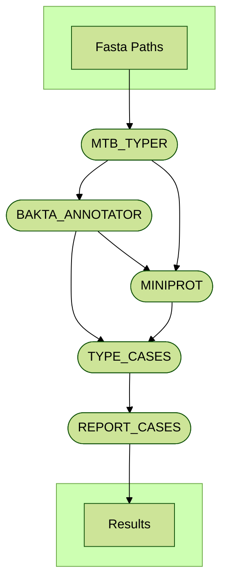

 
    

# AMAP: Assisted MTBC annotator pipeline  

__Paula Ruiz-Rodriguez1__ 
__and Mireia Coscolla1__
 
 1. I2SysBio, University of Valencia-CSIC, FISABIO Joint Research Unit Infection and Public Health, Valencia, Spain   

AMAP is a bioinformatics pipeline in nextflow for processing, annotating and correct annotations of _Mycobacterium tuberculosis_ complex (MTBC) genomes.
## Installation  

## Run AMAP in Nextflow  

## AMAP flowchart

---
<h2 id="contributors" align="center">
✨ Contributors
</h2>

AMAP is developed with ❤️ by:

  

     
  

  

    

      <a href="https://github.com/paururo">
      Paula Ruiz-Rodriguez
      </a>
    

    

      <small>Institute for Integrative Systems Biology</small> 
    
         
  

This project follows the [all-contributors](https://github.com/all-contributors/all-contributors) specification ([emoji key](https://allcontributors.org/docs/en/emoji-key)).

<!-- ALL-CONTRIBUTORS-LIST:START - Do not remove or modify this section -->
<!-- prettier-ignore-start -->
<!-- markdownlint-disable -->

<table>
  <tr>
    <td align="center">
      <a href="https://github.com/mireiacoscolla">
        
         
        <b>Mireia Coscolla</b>
      </a>
       
      <a href="https://www.uv.es/instituto-biologia-integrativa-sistemas-i2sysbio/es/investigacion/proyectos/proyectos-actuales/mol-tb-host-1286169137294/ProjecteInves.html?id=1286289780236" title="Funding/Grant Finders">🔍</a>
      <a href="" title="Ideas">🤔</a>
      <a href="" title="Mentoring">🧑‍🏫</a>
    </td> 
  </tr>
</table>

<!-- markdownlint-restore -->
<!-- prettier-ignore-end -->

<!-- ALL-CONTRIBUTORS-LIST:END -->
---  

<h2 id="contributors" align="center">
💻 Software Used
</h2>

1. [Nextflow](https://github.com/nextflow-io/nextflow) v23.10.1:  
    >Di Tommaso, P., Chatzou, M., Floden, E. W., Barja, P. P., Palumbo, E., & Notredame, C. (2017). Nextflow enables reproducible computational workflows. Nature biotechnology, 35(4), 316–319. https://doi.org/10.1038/nbt.3820
2. [Bakta](https://github.com/oschwengers/bakta) v1.9.3:  
    >Schwengers, O., Jelonek, L., Dieckmann, M. A., Beyvers, S., Blom, J., & Goesmann, A. (2021). Bakta: rapid and standardized annotation of bacterial genomes via alignment-free sequence identification. Microbial genomics, 7(11), 000685. https://doi.org/10.1099/mgen.0.000685
3. [miniprot](https://github.com/lh3/miniprot) v0.13:
    >Li H. (2023). Protein-to-genome alignment with miniprot. Bioinformatics (Oxford, England), 39(1), btad014. https://doi.org/10.1093/bioinformatics/btad014
4. [Python](https://www.python.org/) v3.9:
    >Van Rossum, G., & Drake, F. L. (1995). Python reference manual (Vol. 111, pp. 1-52). Amsterdam: Centrum voor Wiskunde en Informatica.
5. [R](https://www.R-project.org/) v4.3.3:
    >R Core Team (2021). R: A language and environment for statistical computing. R Foundation for Statistical Computing, Vienna, Austria.
6. [pandas](https://github.com/pandas-dev/pandas) v2.2.1:
    >McKinney, W., & others. (2010). Data structures for statistical computing in python. In Proceedings of the 9th Python in Science Conference (Vol. 445, pp. 51–56).
7. [intervaltree](https://github.com/chaimleib/intervaltree) v3.1.0
8. [plotly.py](https://github.com/plotly/plotly.py) v5.20.0:
    >Inc., P. T. (2015). Collaborative data science. Montreal, QC: Plotly Technologies Inc. Retrieved from https://plot.ly
9. [ggplot2](https://ggplot2.tidyverse.org/index.html) v3.5.0:
    >Wickham H. (2016) ggplot2: Elegant Graphics for Data Analysis. Springer-Verlag New York, https://github.com/tidyverse/ggplot2
10. [dplyr](https://dplyr.tidyverse.org/) v1.1.4:
    >Wickham H, François R, Henry L, Müller K, Vaughan D (2023). dplyr: A Grammar of Data Manipulation. R package version 1.1.4, https://github.com/tidyverse/dplyr