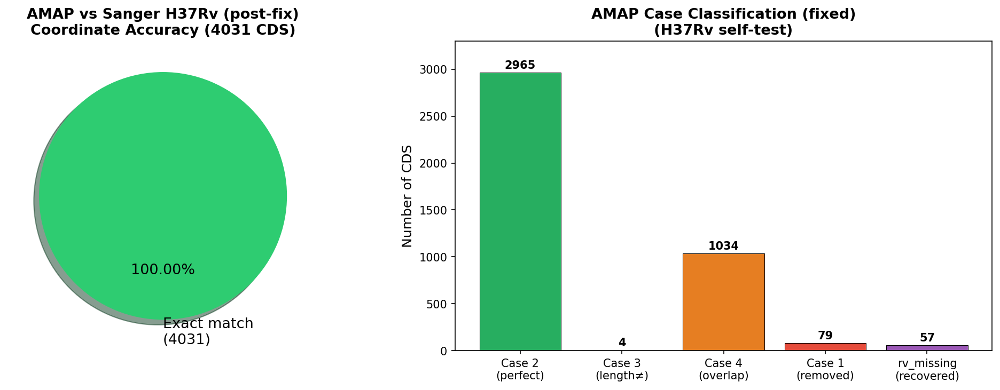
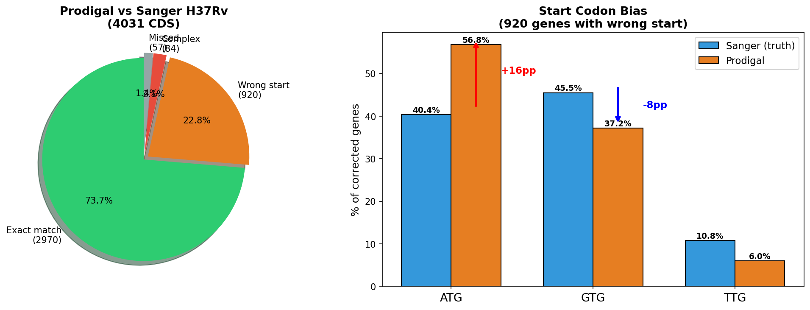
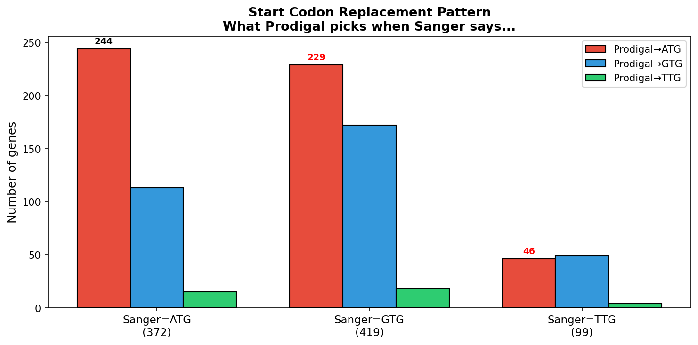
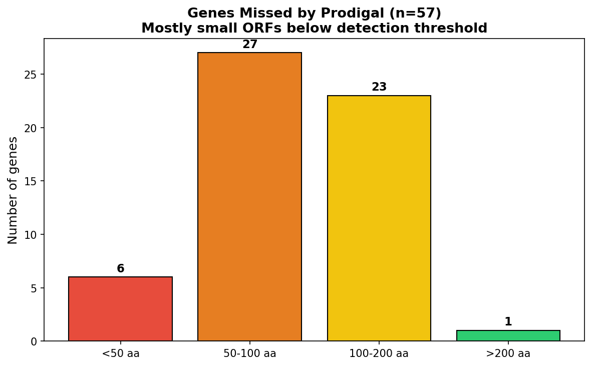
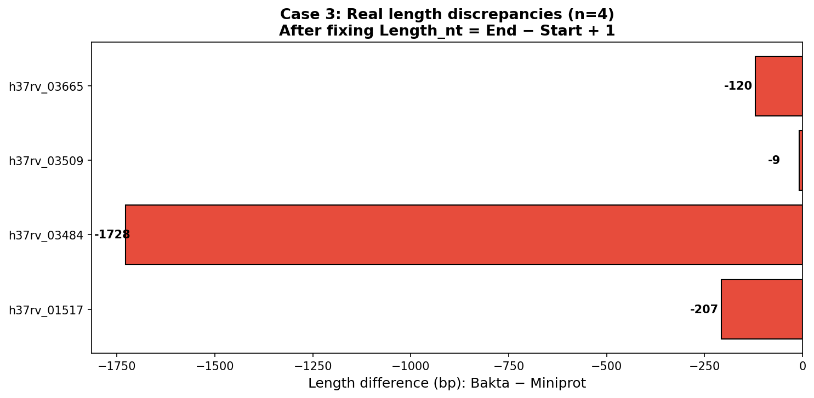
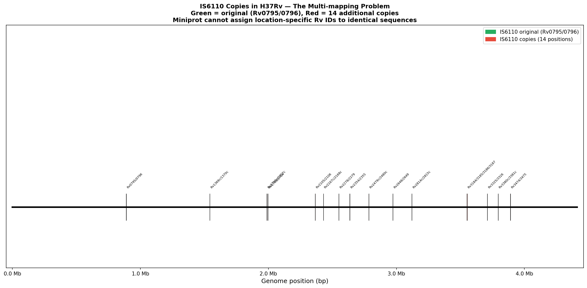
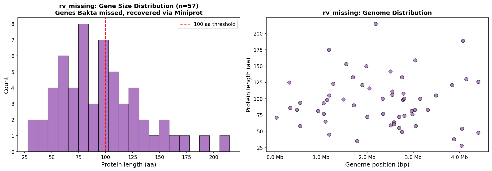
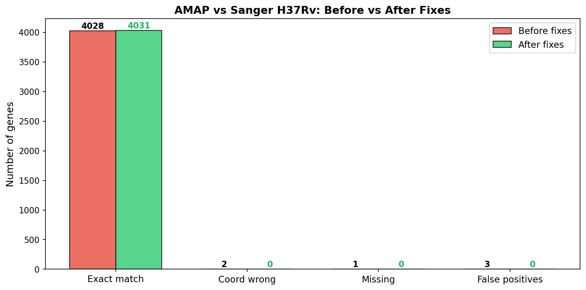

# AMAP Validation: H37Rv Sanger Benchmark

**Pipeline:** AMAP (branch `fix`)  
**Reference:** *M. tuberculosis* H37Rv — Sanger annotation (AL123456.3, 4031 CDS)  
**Annotator:** Bakta 1.12 (Prodigal) → Miniprot → classify_cases.py

---

## 1. Result

| Metric | Value |
|--------|-------|
| Sanger CDS (ground truth) | 4031 |
| AMAP output CDS | 4031 |
| **Exact match (coords + strand)** | **4031 / 4031 (100.00%)** |
| False positives | 0 |
| Missing genes | 0 |



---

## 2. Why AMAP Needs to Correct Prodigal

Prodigal (the gene caller inside Bakta) fails on **26.3%** of H37Rv genes:

| Category | N genes | % |
|----------|---------|---|
| Exact match | 2970 | 73.7% |
| **Wrong start site** (correct stop) | **920** | **22.8%** |
| Complex misannotation | 84 | 2.1% |
| Not detected | 57 | 1.4% |
| **False positives** (Prodigal invents) | **78** | — |



---

## 3. The ATG Bias Problem

The dominant error (920 genes) is **incorrect start codon selection**. Prodigal systematically over-selects ATG at the expense of GTG and TTG.

| Codon | Sanger (truth) | Prodigal | Bias |
|-------|----------------|----------|------|
| **ATG** | 372 (40.4%) | 523 (56.8%) | **+16pp over-selected** |
| **GTG** | 419 (45.5%) | 342 (37.2%) | −8pp under-selected |
| **TTG** | 99 (10.8%) | 55 (6.0%) | −5pp under-selected |

In high-GC organisms like *M. tuberculosis* (65.6% GC), GTG is the **most frequent** legitimate start codon (45.5%), yet Prodigal replaces it with a nearby ATG in 229 genes (54.7% of GTG starts).

### Substitution pattern

| True start (Sanger) | Prodigal → ATG | Prodigal → GTG | Prodigal → TTG |
|---------------------|----------------|----------------|----------------|
| **ATG** (372) | 244 ✓ | 113 | 15 |
| **GTG** (419) | **229** ✗ | 172 ✓ | 18 |
| **TTG** (99) | **46** ✗ | 49 | 4 ✓ |



### Why correct starts matter

- The start codon defines the **N-terminal** of the protein: signal peptides, functional domains, epitopes
- *M. tuberculosis* has widespread **leaderless transcription** (no Shine-Dalgarno), making start signals distinct from *E. coli*
- Wrong starts alter **variant annotation**: a SNP may be classified as intergenic, 5'UTR, or coding depending on the start position
- Start position affects **dN/dS calculations** and selection analyses

---

## 4. Missed Genes (57)

Prodigal fails to detect 57 genes, mostly small ORFs below its scoring threshold:

| Size | N genes |
|------|---------|
| < 50 aa | 6 |
| 50–100 aa | 27 |
| 100–200 aa | 23 |
| > 200 aa | 1 |

88% are < 200 aa. AMAP recovers them via Miniprot alignment of reference proteins (`rv_missing` pathway).



---

## 5. False Positives (78)

Prodigal predicts 78 genes with **no overlap** to any Sanger CDS:

- Median size: 177 bp (59 aa)
- 92% are < 300 bp
- Spurious ORFs in intergenic regions

AMAP removes them via the `case1_removed` pathway: genes with no Miniprot match AND overlap with known false positives (bad_bakta) are eliminated.

---

## 6. AMAP Case Classification

After correction, AMAP classifies genes into:

| Case | Definition | N genes |
|------|-----------|---------|
| **Case 2** | Perfect Bakta-Miniprot match | 2965 |
| **Case 3** | Same coords, different alignment length | 4 |
| **Case 4** | Overlapping but mismatched coords | 1034 |
| **Case 1 removed** | Bakta false positives eliminated | 79 |
| **rv_missing** | Genes recovered via Miniprot | 57 |



---

## 7. IS6110 Multi-copy Elements

H37Rv contains 16 copies of IS6110 (insertion element). Both encoded proteins (long transposase ~987 bp, short ~326 bp) are virtually identical across all copies.

Miniprot maps each protein to all 16 positions simultaneously. AMAP handles this with `_dup_` IDs listing all possible Rv assignments. **Coordinates are correct** at all 16 positions.



---

## 8. Genes Recovered by AMAP

57 genes that Bakta/Prodigal missed are recovered via Miniprot:



---

## 9. Bugs Fixed

| # | Bug | Impact | Fix | Commit |
|---|-----|--------|-----|--------|
| 1 | `Length_nt = End - Start` (off-by-one) | 3245 genes misclassified Case 2→3 | `End - Start + 1` | `b3c814e` |
| 2 | Paralog false positives | 2 FPs (Rv1150/Rv1041c swap) | Embedded coord validation | `fd7ea13` |
| 3 | `reconcile_coordinates` replaces correct Bakta coords | Rv3508 truncated 219 bp | Length ratio check + Bakta restore | `fd7ea13` |
| 4 | `recover_missing_genes` no position validation | Potential FPs | Embedded coord check | `fd7ea13` |



---

## 10. How to Reproduce

```bash
# 1. Annotate H37Rv with Bakta
bakta --db <bakta_db> h37rv.fasta --prefix h37rv

# 2. Extract reference proteins from Sanger GenBank
python3 bin/extract_ref_proteins.py --gbk AL123456.gb --out ref_proteins.faa

# 3. Align with Miniprot
miniprot --trans h37rv.fasta ref_proteins.faa > h37rv.paf

# 4. Run AMAP classification
python3 bin/classify_cases.py \
  -b h37rv.tsv \
  -p h37rv.paf \
  -bb h37rv-badbakta.paf \
  -c h37rv-ref.paf

# 5. Compare output vs Sanger
# h37rv_corrected.tsv should match Sanger exactly (4031/4031)
```

---

*Validation performed April 1, 2026.*
