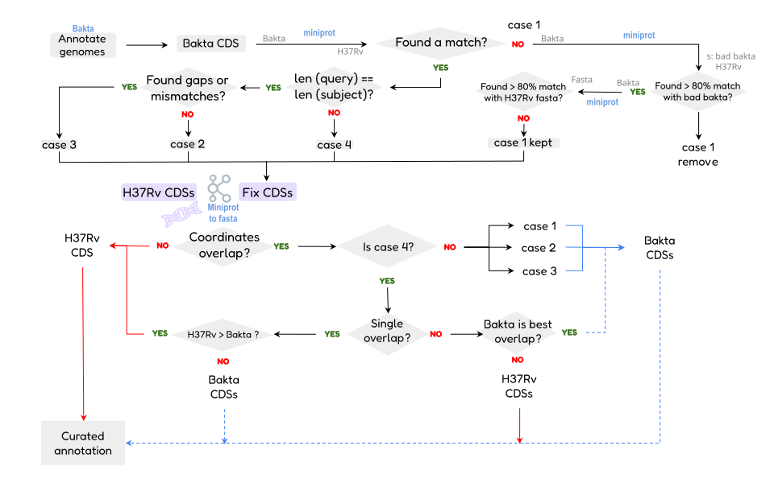

# The correction algorithm

The core of AMAP. It referees between the initial Bakta annotation and the
Miniprot alignments of a trusted reference proteome, classifying every candidate
gene and then applying a set of rules to resolve the disagreements.

Coordinates throughout are 1-based inclusive, so a gene's length is
`end - start + 1`. Every comparison is strand-aware and contig-aware: genes on
opposite strands at the same position are different genes and never conflict,
and nor are genes on different contigs of a draft assembly, where every contig
starts at 1. Bakta runs with `--keep-contig-headers` so that it names the
contigs as the FASTA and Miniprot do; by default it renames them `contig_N`.

## 0. Placements

### Small proteins

Miniprot needs a seed of several residues and enough score to report an
alignment, which a protein of a few dozen residues rarely gives it: annotating
*E. coli* K-12 with its own proteome, it placed none of 33 proteins of 8 to 29
residues, and it put the ldr toxin b4665, 19 residues three of which differ
from its neighbour's, on that neighbour only. Every protein without an exact,
complete placement is looked for in the six-frame translation of the genome,
preceded by a start codon and followed by a stop, and each exact copy found
where Miniprot did not already place the protein becomes a complete placement.
Proteins shorter than 8 residues are not searched.

### Paralog placements

Miniprot places a reference protein everywhere it scores within 5% of its best,
so a protein with a paralog is placed at both loci. Before anything is
classified, each placement is checked against where the protein belongs.

The reference proteome carries each protein's coordinates in its header
(`Rv1150_1278269-1278820`), but those are reference coordinates, and any indel
upstream shifts every position after it. So each placement's reference position
is predicted from the nearest proteins placed only once, which follow the
sample's local offset from the reference, and the placement closest to where the
protein belongs is its **syntenic** one. A placement is then dropped when all of
these hold:

- another protein's syntenic placement covers at least **50%** of it, on the
  same strand and in the **same reading frame**
- that protein matches there **at least as well**
- the two proteins live in different places in the reference, so they are not
  simply neighbours that overlap

What this removes is a protein sitting on someone else's locus: Rv1945 on
Rv1148c, the mce3 genes M. bovis has lost (RD7) on their mce1 paralogs, or the
sixteen other IS6110 names on each IS6110 copy. What it leaves alone is a copy
at a locus no protein claims, such as an IS6110 insertion at a site the
reference lacks or a duplication in the sample, and genes that genuinely
overlap, which sit in different frames (Rv1041c and Rv1042c).

When two proteins both look syntenic at one locus, which happens when a deletion
removes a gene and leaves its paralog next door as the nearest place left, the
better match keeps the locus. CDC1551 lacks Rv3427c and Rv3428c, and without
this Rv3425 and Rv3426 would sit on Rv3429.

## 1. Classification

Every Bakta CDS is compared against the Miniprot alignments.

**Case 2, perfect match.** Same start, same end, same strand as an alignment,
and the same length. Correct, kept as is.

**Case 3, imperfect match.** Same coordinates, but the aligned length differs,
typically from indels. Reliable enough, kept.

**Case 4, conflicting overlap.** A Bakta CDS and an alignment overlap on the
same strand, but their coordinates do not match. This is the conflict that has
to be adjudicated.

**Case 1, potentially novel.** A Bakta CDS with no overlap to any alignment.
Either a genuine gene absent from the reference, or something Bakta invented.

**Missing reference genes.** An alignment with no overlapping Bakta CDS. The
reference has a gene there and the annotator missed it. Alignments with no
aligned bases at all are discarded first.

Each set is written to its own table under `CDS_CASES/`, so the whole decision
is auditable.

## 2. Filtering case 1

Novel-gene candidates are scrutinised before being believed. A candidate is
**removed** if either holds:

- it overlaps the [false-positive set](../user-guide/custom-reference.md) by
  **80% or more** of its own length, meaning it is a call the annotator is known
  to make wrongly on the reference genome itself
- it aligns to the reference at **80% or more** match identity, meaning it is
  not novel at all but a shifted version of a gene that is already there

Candidates that pass both, and candidates with no reference alignment to judge
by, are kept as `case1_kept`.

## 3. Resolving case 4

### Single overlaps

One Bakta CDS against one reference alignment, on the same strand of the same
contig. Lengths are compared, and:

- **the reference wins by default**
- the Bakta version wins only if it is longer by **more than 550 bp**, and the
  alignment is not **complete** in the call's reading frame

The asymmetry is deliberate. A reference alignment is usually the better
boundary, but a much longer Bakta call normally means the alignment fragmented,
and discarding a full-length gene in favour of a partial alignment would be the
worse error. A complete alignment, one that covers the whole reference protein
down to its stop codon, has not fragmented: a longer call in its frame ends at
the same stop and only starts further upstream (plcD, Rv1755c, 843 bp in H37Rv
and 1545 bp in Bakta's call on CDC1551). A call in another frame is another
gene, and keeps its chance to win on length; the alignment then comes back in
step 5. If the Bakta CDS overlaps more than one alignment, the reference wins
regardless.

### Multiple overlaps

Several Bakta CDS against one alignment, the signature of a gene that has been
split. The best-overlapping Bakta CDS is picked first, then compared to the
alignment on length:

- the reference wins if it is at least as long, if the Bakta CDS beats it by
  **less than 500 bp**, if the alignment is complete in the call's frame, or if
  the call overlaps other alignments as well, which makes it several reference
  genes read as one (Rv3022c and Rv3021c are one reading frame in CDC1551)
- otherwise the Bakta CDS wins

## 4. Deduplication on insert

Each winner is checked against the genes already accepted. Where a new
coordinate overlaps an existing one by **70% or more** on the same strand:

- the new gene displaces the existing one if it is longer by **more than 550 bp**
- it also displaces it if the existing gene is shorter by less than that margin
  and is not a reference gene
- otherwise the existing gene stands and the new coordinate is dropped

A reference gene is one whose identifier is a reference protein's. The test
used to look for coordinates embedded in the identifier, which are stripped as
the alignments are read, so no gene qualified and a call of similar length could
displace any of them: Bakta's version of Rv1614, one codon longer, replaced it.

## 5. Rescuing missing genes

A reference protein is missing when no gene accounts for any of its
placements, and then it goes back in at its best one. A gene accounts for a
placement when it sits on it: same contig and strand, the **same reading
frame**, covering at least **50%** of it, and not known to be another reference
gene. The frame matters because genes that really overlap sit in different
frames (Rv0724A and Rv0725c); another reference gene in the same frame does not
count either, since some are nested (*E. coli* hokC inside mokC). Placements on
other genes' loci have already been dropped in step 0, so what is left to rescue
sits where the gene belongs or at a locus nobody claims.

## 6. Final deduplication

Where one gene ends up at several coordinates, entries fully contained inside a
different gene are dropped, always keeping at least one entry per gene so
nothing disappears entirely.

After the stop codon check, `deduplicate_rvs.py` ranks the genes that share a
reference protein: a non-pseudogene over a pseudogene, then the longer one, then
one Bakta also called at exactly those coordinates, then the one nearer where
the protein belongs by synteny. The first keeps its place. The others stay as
**further copies** of the gene when they are at least **90%** as long as the
first, clear of the copies kept, and not covered by another reference gene; a
pseudogene must also be 90% as long as the reference protein, which a piece of
a split gene is not, and anything else is a remnant of the gene and goes. A genome can carry a gene more
than once, and these copies are what the duplication analysis counts: *E. coli*
O157:H7 Sakai keeps 34 that used to be deleted. Copies only Miniprot placed are
all named after their protein, so later ones get `_2`, `_3` to keep identifiers
unique.

## 7. Stop codon check

`check_cds.py` translates every surviving CDS.

It is given the reference proteome, which settles what a translation alone
cannot.

**No terminal stop codon.** Coordinates are extended to the next in-frame stop,
searching 300 bp in the right direction for the strand, or as far as the
reference protein says is missing when that is further. If the extension
introduces internal stops or finds nothing, the original coordinates are kept
and the gene is flagged as a pseudogene.

**An extension goes no further than the reference protein.** A gene may be
extended to a stop at most **10** residues past the end of its reference
protein: that completes an alignment that stopped short. A frame that runs on
further has lost its stop or shifted, and the C-terminus it would add is not
the gene's; the gene keeps its extent and is flagged as a pseudogene, with the
reason, as PGAP and Bakta treat a frameshift. Often that frame runs on into the
next gene, whose stop is then the next one (in M. bovis Rv0590 into Rv0590A and
Rv3373 into Rv3374), and extending would annotate that gene twice.

**Genes a contig cut short are partial.** In a draft assembly, a gene whose
frame reaches the end of its contig with no stop, from within 30 bp of it, was
cut by the assembly: it runs to the last codon there and is marked `3'`
partial. One that opens within a codon of the contig's edge without a start
codon is `5'` partial. Neither is a pseudogene. Only the piece Miniprot places
is annotated, usually the larger one, as it reports only the placements within
5% of a protein's best.

**Reference pseudogenes keep their extent.** When the reference protein spans
its annotated stretch codon for codon with no stop (PE21, Rv2099c; PPE48,
Rv3022c) and the gene ends where it does, the reference annotates it without a
stop, and the gene is left as it is and flagged. A reference pseudogene
annotated with a partial final codon (oxyR', Rv2427A) gets that base back,
since an alignment only covers whole codons.

**Clipped N-termini are restored.** When a gene ends in a stop but is short of
its reference protein at the start, and the codons upstream open with a start
codon and translate to the missing residues, the gene is extended to cover
them. A gene that already starts where its reference does is shorter somewhere
inside, and is left alone.

**Internal stop codons.** Flagged as a pseudogene and kept, with the flag
propagated to the master table and the GFF3. `*-AMAP.clean.faa` excludes them.

**Untranslatable genes are dropped** from the annotation table as well as the
FASTA files, so the two never disagree.

/// caption
Two passes. The top row assigns every Bakta call a case from how it matches the
H37Rv reference. The bottom row takes those cases and decides, wherever the two
sets of coordinates overlap, which one survives into the curated annotation.
///

## Threshold summary

| Threshold | Where | Value |
| :--- | :--- | :--- |
| False-positive overlap | case 1 filtering | 80% |
| Reference match identity | case 1 filtering | 80% |
| Bakta length advantage | single overlaps | 550 bp |
| Bakta length advantage | multiple overlaps | 500 bp |
| Overlap for deduplication | on insert | 70% |
| Length margin for displacement | on insert | 550 bp |
| Distance from the predicted position | paralog placements | 10 kb |
| Proteins placed once, each side, for the local offset | paralog placements | 5 |
| Cover to claim another protein's placement | paralog placements | 50% |
| Shortest protein looked for exactly | small proteins | 8 residues |
| Cover for a gene to account for a placement | rescuing missing genes | 50% |
| Length of a further copy, next to the first | final deduplication | 90% |
| Cover by another reference gene that rules a copy out | final deduplication | 50% |
| Stop codon search | quality control | 300 bp, or what the reference protein is missing |
| Residues an extension may run past the end of the reference protein | quality control | 10 |
| Distance from a contig end within which a gene counts as cut | quality control | 30 bp at the 3' end, a codon at the 5' end |
| Identity to restore a clipped N-terminus | quality control | 90% |

These are constants in `bin/classify/`, tuned on MTBC. Another organism may want
different values, particularly the 550 bp length margins, which assume genes of
roughly bacterial size.

## Next steps

- [The workflow](workflow.md): where this sits in the pipeline
- [Outputs](../user-guide/outputs.md): the case tables that record every decision
