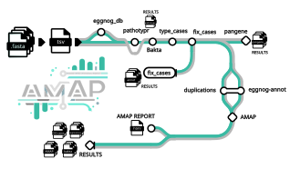

  
  
Assisted Microbial Annotator Pipeline

  

    Reference-guided annotation correction for prokaryotic genomes.
  

  

    version1.0.1
    licenseGPL-3.0
    nextflow&ge;23.04
    tests92 passing
  

  

    <a class="md-button md-button--primary" href="getting-started/tutorial/">
      Start the tutorial
    </a>
    <a class="md-button" href="https://github.com/PathoGenOmics-Lab/AMAP">
      View on GitHub
    </a>
  

**AMAP** takes assembled prokaryotic genomes and produces a corrected,
functionally annotated gene set. It annotates each genome with Bakta, aligns a
trusted reference proteome onto it with Miniprot, and then acts as a referee
between the two: every coding sequence is classified, conflicting coordinates
are resolved, reference genes the annotator missed are rescued, and every final
CDS is checked for a valid stop codon. On MTBC genomes this adjusts roughly 30%
of the genes.

It was built for the *Mycobacterium tuberculosis* complex and ships with the
H37Rv reference, lineage typing and Mycobrowser categories. From v1.0.0 it is
also **organism-agnostic**: point it at any trusted annotation with
`--ref_annotation` and `--ref_genome` and it will correct *E. coli*,
*S. aureus* or anything else. The MTBC-specific steps detect that they do not
apply and step aside.

The run ends in a single self-contained HTML report covering sample quality,
missing reference genes, PE/PPE families, KEGG pathways, gene duplications and
the pangenome.

- :material-rocket-launch: __New here? Start here__

    ---

    From an empty folder to an annotated genome, every command spelled out,
    with the numbers from a real run to check yours against.

    [:octicons-arrow-right-24: Tutorial](getting-started/tutorial.md)

- :material-tune: __Every parameter__

    ---

    All the flags, what they default to, and which ones you actually need to
    touch.

    [:octicons-arrow-right-24: Parameters](user-guide/parameters.md)

- :material-sitemap: __What it actually does__

    ---

    The ten pipeline steps, the case classification, and the rules that decide
    which coordinates win.

    [:octicons-arrow-right-24: How it works](how-it-works/index.md)

- :material-folder-open: __Reading the results__

    ---

    Every directory and file the run produces, and which ones you want.

    [:octicons-arrow-right-24: Outputs](user-guide/outputs.md)

- :material-dna: __Other organisms__

    ---

    Bringing your own reference annotation, and what changes when you do.

    [:octicons-arrow-right-24: Custom reference](user-guide/custom-reference.md)

- :material-server: __Running at scale__

    ---

    SLURM, SGE and PBS profiles, container images, and what to do when a run
    goes wrong.

    [:octicons-arrow-right-24: Deployment](deployment/hpc.md)

## The pipeline at a glance

The map animates: each line traces the route a sample takes through the
pipeline.

  <object class="amap-animated" type="image/svg+xml" data="assets/pipeline-map.svg"
          aria-label="AMAP pipeline map, animated">
    
  </object>

## Citing AMAP

> Ruiz-Rodriguez, P., & Coscolla, M. (2026). AMAP (Version 1.0.1)
> [Computer software]. <https://doi.org/10.5281/zenodo.8024447>

The BibTeX entry is on the [citation page](about/citation.md).
